# Plan: Admin panel for jokes

- Spec: [docs/specs/admin-panel.md](../specs/admin-panel.md)
- Date: 2026-09-30
- Branch: `feature/admin-panel` (one branch; see [Open points](#open-points))

## How to read this plan

- Step 1 is a **walking skeleton**. It makes the main path of the spec work from end to end, with the minimum in each layer:

  > A developer creates an admin with the CLI. The admin logs in, sees the jokes, creates a joke, and the public API returns the new joke.

- Each step after step 1 adds **one thing**. The new code is used by a route, a command or a view in the same step. No step adds code that nothing calls.
- Each step ends with `npm test` green. The public API tests do not change (AC-29).
- Each step lists what you can test when it is done: automated tests and a manual check.
- Each step is one commit, except the skeleton, which has a short list of commits. Every commit passes `npm test`.

## Rules for all steps

- Tests: mostly integration tests with `app.inject()` in `tests/integration/admin/`. Unit tests in `tests/unit/admin/` only where they add value.
- Time: functions that depend on the current time take a `now: Date` parameter. Tests pass a fixed date. No fake timers in integration tests.
- CLI: `src/cli/admin.ts` exports `runAdminCommand(args, io, db)`. The `io` object gives `stdin`, `stdout`, `stderr` and `isInteractive`. A thin entry file calls it with `process` values. Tests call the function directly with an in-memory database.
- `db:init`: `src/db/init.ts` exports `initializeDatabase(db, jokes, options)`. A thin entry file reads the JSON and the flags.
- Views: all output uses `<%= %>` (escaped). Never use `<%~ %>`.
- Tailwind: write full class names in templates. Do not build class names with string concatenation.
- Each step updates the spec cross-reference table at the end of this plan if it changes.

## Overview

```mermaid
flowchart TD
    S0[0. Branch and docs] --> S1

    subgraph M1["M1 · Walking skeleton"]
        S1[1. Login → list → create → public API]
    end

    subgraph M2["M2 · Data safety"]
        S2[2. db:init guard]
    end

    subgraph M3["M3 · Safe sessions (required before public deploy)"]
        S3[3. Logout] --> S4[4. CSRF check]
        S4 --> S5[5. Session expiry]
        S5 --> S6[6. Return to next]
        S6 --> S7[7. Secure cookie by default]
        S7 --> S8[8. Dummy hash]
        S8 --> S9[9. Login concurrency limit]
    end

    subgraph M4["M4 · Look and feel"]
        S10[10. Chiquito Retro base]
    end

    subgraph M5["M5 · Joke management"]
        S11[11. Notices] --> S12[12. Create validation]
        S12 --> S13[13. Edit]
        S13 --> S14[14. Delete with cascade]
        S14 --> S15[15. Category datalist + counter]
    end

    subgraph M6["M6 · Joke list"]
        S16[16. Vote and view columns] --> S17[17. Category filter] --> S18[18. Text search]
        S18 --> S19[19. Pagination]
        S19 --> S20[20. Empty page state]
    end

    subgraph M7["M7 · Admin CLI"]
        S21[21. Password rules] --> S22[22. Duplicate email]
        S22 --> S23[23. Interactive prompt]
        S23 --> S24[24. admin:list]
        S24 --> S25[25. admin:delete]
        S25 --> S26[26. admin:password]
    end

    subgraph M8["M8 · Docs"]
        S27[27. README and AGENTS.md]
    end

    S1 --> S2 --> S3
    S9 --> S10 --> S11
    S15 --> S16
    S20 --> S21
    S26 --> S27
```

The milestones M5, M6 and M7 do not depend on each other. The order above is a proposal. You can change it, but keep M3 before a public deploy.

## Step 0: Branch and documents

Create `feature/admin-panel` from `main`. It takes the uncommitted changes in `main` with it.

Commits:
1. `chore(git): 🙈 ignore .scratchpad folder`
2. `docs(agents): 📝 add working rules for branches, commits and language`
3. `docs(admin): 📝 add admin panel spec`
4. `docs(admin): 📝 add admin panel implementation plan`

**Test when done**
- `git log` shows 4 commits. `git status` is clean.
- `npm test` passes (no code change).

## Step 1: Walking skeleton

Goal: the main path works from end to end. Each layer has the minimum.

| Layer | Minimum in this step |
| --- | --- |
| Database | `admins` and `sessions` tables in `createTables`, with their final columns from spec §5 (there is no migration system, so the tables get their final shape now). Queries: `createAdmin`, `findAdminByEmail`, `createSession`, `findSessionById`, `createJoke` (without id). |
| Password | `hashPassword` and `verifyPassword` with async scrypt, random salt, `timingSafeEqual`. |
| CLI | `npm run admin:create -- --email <email> --password-stdin` only. Email trimmed and lowercase. |
| Session | Cookie `sid` with 32 random bytes, `HttpOnly`, `SameSite=Lax`, `Path=/admin`. The session row gets its `csrf_token`, and forms render it in `_csrf`. The server does not check it yet (step 4). No expiry check yet (step 5). |
| Guard | A hook on `/admin/*` (except `/admin/login` and `/admin/assets`). Without a valid session: `302` to `/admin/login`. |
| Routes | `GET /admin/login`, `POST /admin/login`, `GET /admin` (redirect), `GET /admin/jokes`, `GET /admin/jokes/new`, `POST /admin/jokes`. |
| Login result | Success: `302` to `/admin/jokes`. Failure: `401` with the form and "Invalid email or password." |
| Views | `layout.eta`, `login.eta`, `jokes/list.eta` (all jokes, columns ID, Type, Content, Category), `jokes/form.eta` (type, category, content, no validation). |
| Styles | `src/admin/styles/input.css` with `@import "tailwindcss";`. Script `build:css`. `public/admin/.gitkeep` in git, `public/admin/admin.css` in `.gitignore`. `@fastify/static` serves `/admin/assets`. Only default Tailwind styles. |
| Scripts | `build:css`, `admin:create`. `dev` runs `tsx watch` and the Tailwind watcher together. `build` runs `build:css`, then `tsc`. |

Commits:
1. `feat(db): ✨ add admins and sessions tables`
2. `feat(admin): ✨ add password hash and verify with scrypt`
3. `feat(cli): ✨ add admin:create command with --password-stdin`
4. `build(admin): 🔧 add Tailwind CLI and admin assets folder`
5. `feat(admin): ✨ add login, session guard and joke list`
6. `feat(admin): ✨ add create joke form`

Each commit is used by the next one or by a route in the same commit. The password functions (commit 2) are used by the CLI (commit 3).

**Test when done**
- Unit: `hashPassword` output is not the password. `verifyPassword` is true for the correct password and false for a wrong one. Two hashes of the same password are different.
- Unit: `runAdminCommand(["create", "--email", "Ana@Example.com", "--password-stdin"])` with a password on stdin creates `ana@example.com`.
- Integration: a test helper `loginAs(email)` creates an admin, logs in and returns the cookie. It is used by all admin tests from now on.
- Integration: AC-1 (only the redirect to `/admin/login`, without `next`), AC-2 (cookie attributes, except `Secure` and `next`), AC-3 (without the email value check), AC-15, AC-25.
- Integration: the main path in one test: log in → `GET /admin/jokes` shows the seed jokes → `POST /admin/jokes` → `GET /api/jokes/<new id>` returns the joke.
- Manual: `npm run build:css`, `printf 'a-long-password-1\n' | npm run admin:create -- --email ana@example.com --password-stdin`, `npm run dev`, open `http://localhost:3000/admin`, log in, create a joke, open `/api/jokes/<id>`.

## Step 2: `db:init` guard

Refactor `src/db/init.ts` into `initializeDatabase(db, jokes, { force })` and a thin entry file. Without `--force`, fail if `jokes` has rows. `--force` drops and creates `jokes`, `votes` and `stats` only (the current `dropTables` already does not drop `admins` and `sessions`).

Commit: `feat(db): 🛡️ refuse db:init on a database with jokes unless --force`

**Test when done**
- Unit: AC-27, AC-28 on an in-memory database. The existing `init.test.ts` changes to call `initializeDatabase` instead of mocking modules.
- Manual: `npm run db:init` on the dev database fails. `npm run db:init -- --force` works, and `ana@example.com` can still log in.

## Step 3: Logout

`POST /admin/logout` deletes the session and redirects to `/admin/login?state=loggedout`. The layout shows the admin email and a "Log out" button. The login page shows the `loggedout` message.

Commit: `feat(admin): ✨ add logout`

**Test when done**
- Integration: AC-7 (without the `_csrf` part).
- Manual: log out, then open `/admin/jokes`: you go to the login page.

## Step 4: CSRF check

A `preHandler` on every `POST` under `/admin` (except `/admin/login`) compares `_csrf` with the session `csrf_token` using `timingSafeEqual`. On failure: `403` with `forbidden.eta`. The logout form sends `_csrf` too.

Commit: `feat(admin): 🔒 check CSRF token on admin forms`

**Test when done**
- Integration: AC-8 for `POST /admin/jokes` and `POST /admin/logout`: no `_csrf`, wrong `_csrf`, `_csrf` from another session. No data changes.
- Integration: AC-1b (POST without session → `302` to login).
- Manual: in DevTools, change the hidden `_csrf` value and submit: the 403 page shows.

## Step 5: Session expiry

`createSession` sets `expires_at = now + 24 h`. The guard treats an expired session as missing: it deletes it and redirects to `/admin/login?state=expired`. Each login deletes all expired sessions. All dates use one format: ISO 8601 UTC from `Date.toISOString()`.

Commit: `feat(admin): ⏱️ expire sessions 24 hours after login`

**Test when done**
- Unit: session is valid at `login + 23:59:59` and expired at `login + 24:00:00` (with an injected `now`).
- Integration: AC-6 (without `next`). AC-2 check of `expires_at`.
- Manual: in SQLite, set `expires_at` of your session to the past, reload: you see "Your session expired."

## Step 6: Return to `next`

The guard adds `next=<requested path>` to the login redirect (for `GET` only). The login form keeps `next` in a hidden field. After login, go to `next` only if it is safe (spec §3.3). The failed login form keeps the email value.

Commit: `feat(admin): ✨ return to the requested page after login`

**Test when done**
- Unit: `isSafeNext` accepts `/admin/jokes/5/edit`. It rejects `https://evil.example`, `//evil.example`, `/api/jokes`, `/admin` without the slash, and empty values.
- Integration: AC-1 (full), AC-4, AC-6 (full, with `next`), AC-3 (email value kept).
- Manual: open `/admin/jokes/new` without a session, log in: you arrive at the create form.

## Step 7: Secure cookie by default

Read `COOKIE_SECURE`. `Secure` is on unless the value is `false`. The `dev` script sets `COOKIE_SECURE=false`.

Commit: `feat(admin): 🔒 set Secure on the session cookie by default`

**Test when done**
- Integration: AC-5 and AC-5b.
- Manual: `npm run dev` still works on `http://localhost:3000/admin`. `npm start` without the variable sets a `Secure` cookie (visible in DevTools).

## Step 8: Dummy hash for unknown emails

When the email does not exist, run `verifyPassword` against a fixed dummy hash (created once at start-up), then return the generic error.

Commit: `fix(admin): 🔒 hide which admin emails exist on login`

**Test when done**
- Integration: AC-3b. Spy on `verifyPassword`: it runs once for an unknown email. The response is equal to the wrong-password response.

## Step 9: Login concurrency limit

A counter of verifications in progress in the login handler. At 4, answer `503` with the login form and "The server is busy. Try again in a moment." The counter goes down in a `finally` block.

Commit: `feat(admin): 🛡️ limit concurrent login verifications`

**Test when done**
- Unit: the limiter accepts 4, rejects the fifth, and accepts again after one finishes, also when a verification throws.
- Integration: AC-3c. Make `verifyPassword` wait on a promise that the test controls. Start 4 logins, send a fifth: `503`. During that time, `GET /api/jokes` answers `200`.

**Milestone M3 is complete. The panel is safe to put on the internet.**

## Step 10: Chiquito Retro base

Add the design tokens from spec §6 to `input.css` (Tailwind v4 `@theme`: colors, fonts, hard shadows). Style `layout.eta`, `login.eta`, `jokes/list.eta`, `jokes/form.eta` and `forbidden.eta` with the prototype C look. Type badges as stickers. Visible focus outline. Table scrolls inside its card at 375 px. Fonts: see [Open points](#open-points).

Commit: `style(admin): 💄 apply Chiquito Retro design`

**Test when done**
- Integration: the existing tests still pass (no behavior change).
- Manual: compare each screen with `.scratchpad/prototype/style-c/` at 1280 px and 375 px. Use the keyboard only: every control shows the focus outline.

## Step 11: Notices

After `POST /admin/jokes`, redirect to `/admin/jokes?notice=created`. The list shows a notice for `welcome`, `created`, `updated` and `deleted`. It ignores unknown values. Login success redirects to the list with `notice=welcome` only when `next` is not used.

Commit: `feat(admin): ✨ show notices after actions`

**Test when done**
- Integration: AC-26. AC-15 (redirect with `notice=created`).
- Manual: create a joke: you see "Joke created."

## Step 12: Create validation

`validateJokeForm` checks `type`, `category` and `content` (spec §3.4). On error: `400` with the form, the sent values and one message for each field. Trim the values before saving.

Commit: `feat(admin): ✅ validate the joke form`

**Test when done**
- Unit: `validateJokeForm` for each rule, including the 1000-character limit (1000 passes, 1001 fails) and trimmed values.
- Integration: AC-16 for create.
- Manual: send an empty form: the errors show and the values stay.

## Step 13: Edit

`GET /admin/jokes/:id/edit` and `POST /admin/jokes/:id` with the same form and validation. Unknown or non-numeric id: `404` HTML page. Add the "Edit" action to the list. Redirect with `notice=updated`.

Commit: `feat(admin): ✨ edit jokes`

**Test when done**
- Integration: AC-17, AC-16 for edit, AC-20 for edit (including `/admin/jokes/abc/edit`).
- Manual: edit joke 5, then open `/api/jokes/5`.

## Step 14: Delete with cascade

Query `deleteJokeWithVotesAndStats(db, id)` in one transaction (votes, stats, joke). Query `getJokeDeleteImpact(db, id)` returns the vote and view counts. `GET /admin/jokes/:id/delete` shows the confirmation. `POST /admin/jokes/:id/delete` deletes and redirects with `notice=deleted`. Add "Delete" to the list and "Delete this joke" to the edit form.

Commit: `feat(admin): ✨ delete jokes with their votes and stats`

**Test when done**
- Unit: after the delete, no rows for the joke exist in `jokes`, `votes` or `stats`. A joke with no votes and no stats also deletes.
- Integration: AC-18, AC-19, AC-20 for delete.
- Manual: vote on a joke with `POST /api/jokes/:id/vote`, then delete it from the panel: the confirmation shows the numbers.

## Step 15: Category datalist and character counter

The form adds a `<datalist>` with `getCategories`. A small inline script shows "N / 1000" and uses the error color above 1000. The form works without JavaScript.

Commit: `feat(admin): ✨ suggest categories and count content characters`

**Test when done**
- Integration: the form HTML contains a `<datalist>` with the current categories.
- Manual: type in the content field: the counter changes. Disable JavaScript: the form still submits.

## Step 16: Vote and view columns

The list query joins `votes` and `stats`. The list adds the Up, Down and Views columns.

Commit: `feat(admin): ✨ show votes and views in the joke list`

**Test when done**
- Integration: after two up votes and one down vote on joke 1, and one `GET /api/jokes/1`, the row of joke 1 shows 2, 1 and 1.

## Step 17: Category filter

The list reads `category` from the query string. The toolbar has the category select and a "Filter" button.

Commit: `feat(admin): ✨ filter the joke list by category`

**Test when done**
- Integration: `?category=clásico` shows only that category, and the select shows it as selected.

## Step 18: Text search

Register a SQLite function `lower_text` with `db.function` in `connection.ts` (also for `getDatabase(":memory:")`). The query uses `lower_text(content) LIKE ? ESCAPE '\'` and escapes `%`, `_` and `\`. The toolbar adds the search input. Search works together with the category filter.

Commit: `feat(admin): ✨ search jokes by content`

**Test when done**
- Unit: `escapeLikePattern` for `%`, `_`, `\`.
- Integration: AC-23, AC-23b, AC-23c.
- Manual: search `FISTRO`.

## Step 19: Pagination

`countJokes` and a paged list query with `LIMIT 20 OFFSET ...`, ordered by id. The pagination bar keeps `category` and `q`. An invalid `page` (not a number, zero, negative) means page 1.

Commit: `feat(admin): ✨ paginate the joke list`

**Test when done**
- Unit: `paginate(total, page, size)` for first, middle, last and invalid pages.
- Integration: AC-21, AC-22 (insert 27 extra jokes in the test to reach 45).
- Manual: create jokes until you have 21: page 2 shows.

## Step 20: Empty page state

When the page has no rows, show "No jokes on this page." and a link to page 1.

Commit: `feat(admin): ✨ show an empty state for pages without jokes`

**Test when done**
- Integration: AC-24.

## Step 21: Password rules in the CLI

`validatePassword` checks 12 to 128 characters. `admin:create --password-stdin` uses it.

Commit: `feat(cli): ✅ validate admin password length`

**Test when done**
- Unit: 11 fails, 12 passes, 128 passes, 129 fails.
- Unit: AC-10 (length part), AC-11b.

## Step 22: Duplicate email

`admin:create` fails with a clear message and a non-zero code when the email exists (in any letter case).

Commit: `feat(cli): ✨ refuse duplicate admin emails`

**Test when done**
- Unit: AC-11.

## Step 23: Interactive password prompt

Without `--password-stdin` and with an interactive terminal, ask for the password two times without echo (raw mode on stdin). Different values fail. Without a terminal and without the flag, fail with the `--password-stdin` message.

Commit: `feat(cli): ✨ ask for the admin password without echo`

**Test when done**
- Unit: with a fake interactive `io`: AC-9, AC-10 (confirmation part). With a non-interactive `io`: AC-11c.
- Manual: `npm run admin:create -- --email bea@example.com`: the password does not show while you type.

## Step 24: `admin:list`

Commit: `feat(cli): ✨ add admin:list command`

**Test when done**
- Unit: AC-12. The output does not contain `password_hash` values.
- Manual: `npm run admin:list`.

## Step 25: `admin:delete`

Delete the admin. `ON DELETE CASCADE` on `sessions` deletes the sessions.

Commit: `feat(cli): ✨ add admin:delete command`

**Test when done**
- Unit: the admin and the sessions do not exist after the command.
- Integration: AC-13 (log in, run the command function, the old cookie is redirected to the login page).

## Step 26: `admin:password`

Change the hash and delete all sessions of that admin. Supports the prompt and `--password-stdin`.

Commit: `feat(cli): ✨ add admin:password command`

**Test when done**
- Unit and integration: AC-14.

## Step 27: README and AGENTS.md

- README: how to build the CSS, create the first admin, start the panel, and the CLI commands.
- `AGENTS.md`: `/admin` routes are HTML and are not in `spec/openapi.yaml`. Add `COOKIE_SECURE` to the environment table. Add the new folders to the architecture list.

Commit: `docs(admin): 📝 document the admin panel and CLI`

**Test when done**
- Manual: follow the README from a fresh clone: `npm ci`, `npm run db:init`, `npm run build:css`, create an admin, `npm run dev`, log in.
- `npm test` passes.

## Acceptance criteria coverage

| AC | Step | AC | Step | AC | Step |
| --- | --- | --- | --- | --- | --- |
| AC-1 | 1, 6 | AC-8 | 4 | AC-18 | 14 |
| AC-1b | 4 | AC-9 | 23 | AC-19 | 14 |
| AC-2 | 1, 5 | AC-10 | 21, 23 | AC-20 | 13, 14 |
| AC-3 | 1, 6 | AC-11 | 22 | AC-21 | 19 |
| AC-3b | 8 | AC-11b | 21 | AC-22 | 19 |
| AC-3c | 9 | AC-11c | 23 | AC-23 | 18 |
| AC-4 | 6 | AC-12 | 24 | AC-23b | 18 |
| AC-5 | 7 | AC-13 | 25 | AC-23c | 18 |
| AC-5b | 7 | AC-14 | 26 | AC-24 | 20 |
| AC-6 | 5, 6 | AC-15 | 1, 11 | AC-25 | 1 |
| AC-7 | 3, 4 | AC-16 | 12, 13 | AC-26 | 11 |
| | | AC-17 | 13 | AC-27 | 2 |
| | | | | AC-28 | 2 |
| | | | | AC-29 | every step |

## Open points

- **Branches.** This plan uses one branch. The spec §12 still lists this as not confirmed.
- **Fonts (step 10).** Self-hosted files or Google Fonts. Spec §12 proposes self-hosted.
- **`dev` script (step 1).** Running `tsx watch` and the Tailwind watcher together needs either a shell `&` (works on macOS and Linux, not on Windows `cmd`) or a new development dependency (for example `concurrently`). Proposal: shell `&`, because the project runs on macOS.
- **Manual check in a browser.** Spec §12 lists it as optional. The "Test when done" manual checks in this plan are the proposal.

## Implementation notes

The plan was implemented on 2026-09-30. These points are different from the plan:

- **Step 1** stores `expires_at` (login + 24 hours) from the start, because the column is `NOT NULL`. Step 5 adds only the expiry check and the clean-up.
- **Step 4** runs the CSRF check in the `preValidation` hook, so a form with a wrong token gets `403` before any field validation.
- **Step 11** adds only the `welcome` and `created` notices. Steps 13 and 14 add `updated` and `deleted` with their routes.
- **Steps 16 to 27** have numbers one higher than in the first version of this plan, because "Vote and view columns" became its own step.
- **Step 26** also moves the CLI failures to one `CommandFailure` error (ADR 0015).
- The `.gitignore` rule `public` (from a Gatsby template) was removed, and Biome now parses Tailwind directives (ADR 0011).
- New ADRs: 0013 (character counting), 0014 (`next` validation), 0015 (CLI input and output).
