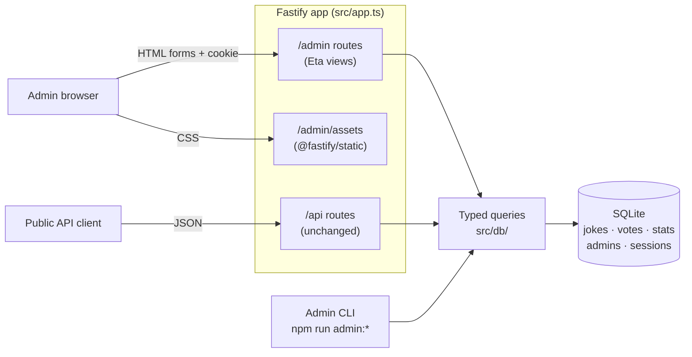
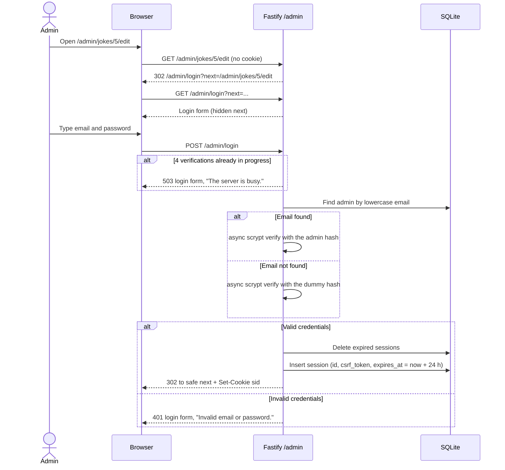
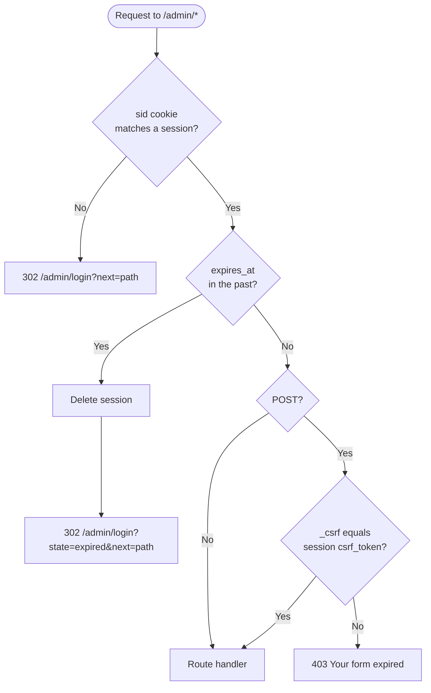
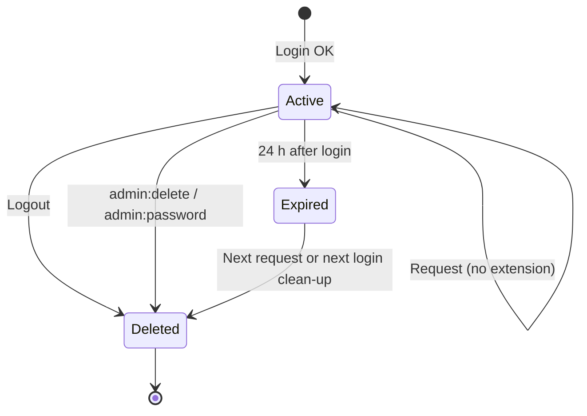
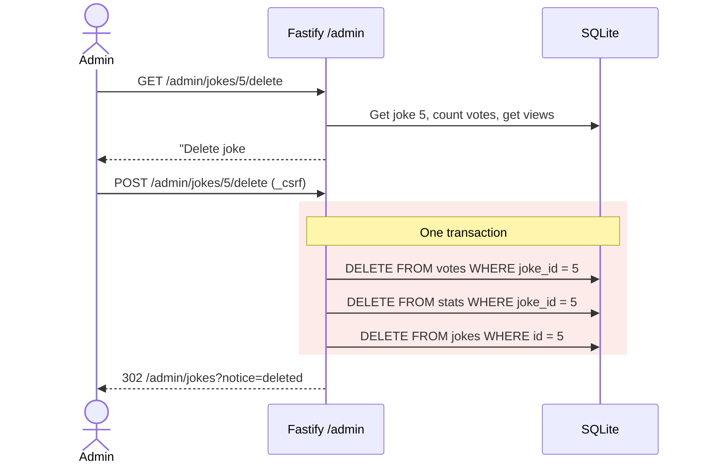
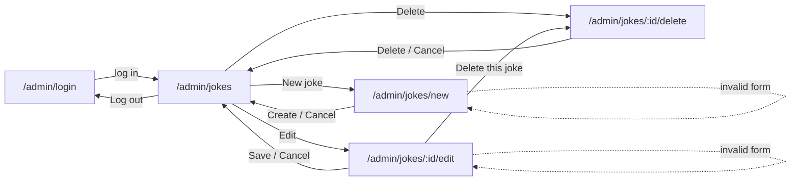
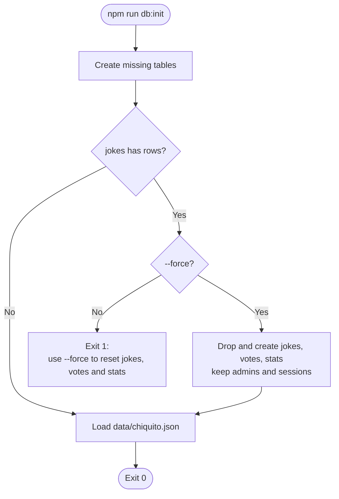
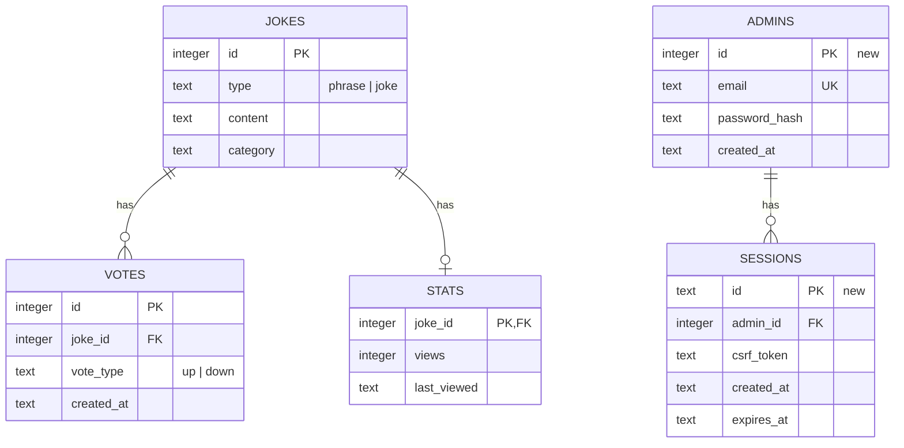

# Spec: Admin panel for jokes

- Status: Draft
- Date: 2026-09-30
- Visual reference: prototype style C "Chiquito Retro" (not in git; see [Visual design](#visual-design))

## TL;DR

- We add a private website where a small team can look after the jokes.
- Each team member has their own email and password. Only these people can go in.
- In the website, you can see all the jokes, find a joke, add a new joke, change a joke, and remove a joke.
- When you remove a joke, its votes and views go too. The website asks you first and tells you how many votes and views you will lose.
- The public joke service does not change. Apps that use it today keep working.
- After 24 hours, you must log in again.
- New team members are added by a developer with a command, not in the website.
- The look is playful and inspired by 1990s Spanish TV, but it stays easy to read.
- We do not stop people who try many passwords. We know this is a risk and we accept it for now.

```
        Team member                         Public apps
             │                                   │
             ▼                                   ▼
   ┌───────────────────┐              ┌───────────────────┐
   │   Admin website   │              │  Public joke API  │
   │   (email + pass)  │              │   (no changes)    │
   └─────────┬─────────┘              └─────────┬─────────┘
             │        same server, same data    │
             └────────────────┬─────────────────┘
                              ▼
                     ┌─────────────────┐
                     │  Joke database  │
                     └─────────────────┘
```

## 1. Goal

Admins manage the jokes (list, create, edit, delete) through a web panel. The panel is protected by authentication. The public JSON API does not change its contract.

## 2. Context

- The project is a JSON API only. It has no frontend and no authentication.
- The `jokes.id` column is `INTEGER PRIMARY KEY`. The ids come from `data/chiquito.json`.
- The `votes` and `stats` tables have foreign keys to `jokes` without `ON DELETE CASCADE`. `foreign_keys` is `ON`. Thus, a joke with votes or views cannot be deleted now.
- `npm run db:init` drops all tables and loads the JSON again. Without a change, it deletes all the data that admins create.

## 3. Decisions

### 3.1 Panel

| Topic | Decision |
| --- | --- |
| Type | Server-rendered HTML, served by the same Fastify app under `/admin`. |
| Templates | `@fastify/view` with Eta. Eta escapes output by default. |
| Styles | Tailwind CSS v4 through `@tailwindcss/cli`. The CLI generates one CSS file. `@fastify/static` serves it under `/admin/assets`. The generated file is in `.gitignore`. |
| Language | All UI text is in English. Chiquito references are allowed in notices and empty states. |
| JavaScript | Not necessary for any feature. Small scripts for progressive enhancement only (for example, the character counter). |
| OpenAPI | `/admin` routes return HTML. They are not in `spec/openapi.yaml`. `AGENTS.md` and `README.md` document this. |

Architecture:



Proposed file layout (new files are marked `+`, changed files `~`):

```
.
├── public/
│   └── admin/
│       ├── + .gitkeep
│       └── + admin.css              (generated, ignored by git)
├── src/
│   ├── ~ app.ts                     (registers the admin plugin)
│   ├── admin/
│   │   ├── + plugin.ts              (cookie, formbody, view, static, routes)
│   │   ├── + auth.ts                (session guard, CSRF check, safe next)
│   │   ├── + password.ts            (scrypt hash and verify)
│   │   ├── + validation.ts          (joke form rules)
│   │   ├── + pagination.ts
│   │   ├── routes/
│   │   │   ├── + session-routes.ts  (login, logout)
│   │   │   └── + joke-routes.ts     (list, create, edit, delete)
│   │   ├── styles/
│   │   │   └── + input.css          (Tailwind entry point)
│   │   └── views/
│   │       ├── + layout.eta
│   │       ├── + login.eta
│   │       ├── + forbidden.eta
│   │       └── jokes/
│   │           ├── + list.eta
│   │           ├── + form.eta       (create and edit)
│   │           └── + delete.eta
│   ├── cli/
│   │   └── + admin.ts               (create, list, delete, password)
│   └── db/
│       ├── ~ schema.ts              (admins, sessions)
│       ├── ~ queries.ts             (joke CRUD, search, pagination)
│       ├── + admin-queries.ts       (admins, sessions)
│       └── ~ init.ts                (--force guard)
└── tests/
    ├── unit/                        (password, auth, validation, pagination, init)
    └── integration/                 (admin session and joke routes)
```

### 3.2 Admins

| Topic | Decision |
| --- | --- |
| Users | Many admins. All admins have the same permissions. |
| Identifier | Email. Stored trimmed and in lowercase. Unique. The app sends no email. |
| Password rules | Minimum 12 characters. Maximum 128 characters. No composition rules. No expiry. |
| Password hash | `scrypt` from `node:crypto`, asynchronous version (it runs in the libuv thread pool, not in the event loop), with a random salt for each password. Compare with `timingSafeEqual`. |
| Management | CLI only. The panel does not manage admins. |

CLI commands:

| Command | Behavior |
| --- | --- |
| `npm run admin:create -- --email <email> [--password-stdin]` | Asks for the password two times, without echo. With `--password-stdin`, reads the password from the first line of standard input and does not ask for confirmation. Fails if the email exists or the password breaks the rules. |
| `npm run admin:list` | Prints id, email and creation date. Never prints hashes. |
| `npm run admin:delete -- --email <email>` | Deletes the admin and all the sessions of that admin. |
| `npm run admin:password -- --email <email> [--password-stdin]` | Asks for a new password two times, without echo. With `--password-stdin`, reads it from the first line of standard input. Deletes all the sessions of that admin. |

Use `--password-stdin` where no interactive terminal exists (Docker, CI, deploy scripts), for example `printf '%s\n' "$ADMIN_PASSWORD" | npm run admin:create -- --email ana@example.com --password-stdin`. Without `--password-stdin` and without an interactive terminal, the command fails with a message that tells the user to use `--password-stdin`.

### 3.3 Sessions and security

| Topic | Decision |
| --- | --- |
| Storage | Table `sessions` in SQLite: `id`, `admin_id`, `csrf_token`, `created_at`, `expires_at`. `id` holds the SHA-256 hash (hex) of the cookie value, not the cookie value. The server finds and deletes sessions by this hash. |
| Cookie | Name `sid`. Value: 32 random bytes. `HttpOnly`, `SameSite=Lax`, `Path=/admin`, `Secure`. `Secure` is on by default. Only `COOKIE_SECURE=false` turns it off (for local HTTP). `NODE_ENV` has no effect on it. |
| Lifetime | 24 hours, absolute, from login. Activity does not extend it. |
| Clean-up | A request with an expired session deletes that session. Each login also deletes all expired sessions. |
| CSRF | Each session has a random `csrf_token`. Every state-changing form sends it in the hidden field `_csrf`. The server compares it with `timingSafeEqual`. |
| Login errors | One generic message: "Invalid email or password." |
| Email enumeration | When the email does not exist, the server verifies the password against a fixed dummy hash. Thus, the response time is the same for known and unknown emails. |
| Redirect after login | To `next` if `next` starts with `/admin/` and has no scheme or host. Otherwise to `/admin/jokes`. |
| Rate limit | None. See [Known risks](#8-known-risks). |
| Login concurrency | Maximum 4 password verifications at the same time, in the whole process. A login request that arrives when 4 are in progress gets `503` with the login form and the message "The server is busy. Try again in a moment." The request does not wait in a queue. This protects the public API from CPU and thread-pool exhaustion. |

Login flow:



Checks on every `/admin` request (except `/admin/login` and `/admin/assets`):



Session lifecycle:



### 3.4 Jokes

| Topic | Decision |
| --- | --- |
| Create | The database assigns the id. The form does not send an id. SQLite can use again the id of the last deleted joke. |
| Validation | `type` is `phrase` or `joke`. `category` is required, trimmed, free text, with a `<datalist>` of the current categories. `content` is required, trimmed, 1000 characters maximum. |
| Delete | Hard delete. One transaction deletes the rows in `votes`, then in `stats`, then in `jokes`. No schema migration. A confirmation page shows the number of votes and views that the operation deletes. |
| Feedback | After create, update or delete, the server redirects to the list with `?notice=created`, `updated` or `deleted`. |
| Audit | None. |

Delete flow:



### 3.5 Joke list

- Filters: category (`category`), text search in content (`q`), and page (`page`). All three are in the query string and work together.
- Category filter: exact match.
- Text search:
  - Case-insensitive for all letters, including accented letters (`FISTRO` finds `fistro`, `ÉL` finds `él`).
  - Accent-sensitive (`clasico` does not find `clásico`).
  - The app registers a SQLite function with better-sqlite3 (`db.function`) that returns `value.toLowerCase()`. The query compares the lowercase content with the lowercase search text. SQLite `LIKE` alone is not sufficient, because it ignores case only for ASCII letters.
  - `%`, `_` and `\` in `q` are literal characters. The query escapes them and uses `LIKE ... ESCAPE '\'`.
- Page size: 20. Order: `id` ascending.
- Columns: ID, Type, Content, Category, Up, Down, Views, Actions.
- Pagination bar: "« Previous", "Page N of M (T jokes)", "Next »".
- A page after the last page shows "No jokes on this page." and a link to page 1.

List screen layout:

```
┌──────────────────────────────────────────────────────────────────────┐
│ CHIQUITO ADMIN                         ana@example.com   [ Log out ] │
├──────────────────────────────────────────────────────────────────────┤
│ ┌──────────────────────────────────────────────────────────────────┐ │
│ │ (i) Joke created.                                            [x] │ │
│ └──────────────────────────────────────────────────────────────────┘ │
│ [ All categories ▼ ] [ Search content…        ] [ Filter ] [+ New ]  │
│ ┌────┬────────┬──────────────────────┬──────────┬────┬────┬───────┐  │
│ │ ID │ TYPE   │ CONTENT              │ CATEGORY │ UP │ DN │ VIEWS │… │
│ ├────┼────────┼──────────────────────┼──────────┼────┼────┼───────┤  │
│ │  1 │ phrase │ ¡Hasta luego, Lucas! │ clásico  │ 24 │  2 │  130  │… │
│ │  5 │ phrase │ ¡Fistro duodenal!    │ clásico  │  9 │  3 │   40  │… │
│ │ …  │        │                      │          │    │    │       │  │
│ └────┴────────┴──────────────────────┴──────────┴────┴────┴───────┘  │
│        « Previous      Page 1 of 1 (18 jokes)      Next »            │
└──────────────────────────────────────────────────────────────────────┘
                               … = [ Edit ] [ Delete ]
```

Screen map:



### 3.6 Database initialization

- `npm run db:init` fails if the `jokes` table has rows. The message tells the user to use `--force`.
- `npm run db:init -- --force` drops and creates again only `jokes`, `votes` and `stats`, then loads the JSON. It does not touch `admins` or `sessions`.
- After the first load, SQLite is the source of truth. `data/chiquito.json` is only seed data.



## 4. Routes

| Method | Path | Session | Result |
| --- | --- | --- | --- |
| GET | `/admin/login` | No | Login form. |
| POST | `/admin/login` | No | Creates a session. Redirects to `next` or `/admin/jokes`. |
| POST | `/admin/logout` | Yes | Deletes the session. Redirects to `/admin/login?state=loggedout`. |
| GET | `/admin` | Yes | Redirects to `/admin/jokes`. |
| GET | `/admin/jokes` | Yes | List with filters and pagination. |
| GET | `/admin/jokes/new` | Yes | Create form. |
| POST | `/admin/jokes` | Yes | Creates a joke. |
| GET | `/admin/jokes/:id/edit` | Yes | Edit form. |
| POST | `/admin/jokes/:id` | Yes | Updates a joke. |
| GET | `/admin/jokes/:id/delete` | Yes | Delete confirmation. |
| POST | `/admin/jokes/:id/delete` | Yes | Deletes a joke, its votes and its stats. |

## 5. Data model changes

```sql
CREATE TABLE IF NOT EXISTS admins (
  id INTEGER PRIMARY KEY AUTOINCREMENT,
  email TEXT NOT NULL UNIQUE,
  password_hash TEXT NOT NULL,
  created_at TEXT NOT NULL DEFAULT CURRENT_TIMESTAMP
);

CREATE TABLE IF NOT EXISTS sessions (
  id TEXT PRIMARY KEY,
  admin_id INTEGER NOT NULL,
  csrf_token TEXT NOT NULL,
  created_at TEXT NOT NULL,
  expires_at TEXT NOT NULL,
  FOREIGN KEY (admin_id) REFERENCES admins(id) ON DELETE CASCADE
);

CREATE INDEX IF NOT EXISTS idx_votes_joke_id_vote_type ON votes(joke_id, vote_type);
CREATE INDEX IF NOT EXISTS idx_sessions_admin_id ON sessions(admin_id);
CREATE INDEX IF NOT EXISTS idx_sessions_expires_at ON sessions(expires_at);
```

The `jokes`, `votes` and `stats` tables do not change. The new indexes have these functions:

| Index | Used by |
| --- | --- |
| `idx_votes_joke_id_vote_type` | The vote counts for each row of the joke list. Without it, each count does a full scan of `votes`. |
| `idx_sessions_admin_id` | `admin:password` and `admin:delete`, which delete the sessions of one admin. |
| `idx_sessions_expires_at` | The clean-up of expired sessions at each login. |



## 6. Visual design

The design follows prototype style C "Chiquito Retro": a playful 1990s Spanish TV look that stays clear and readable.

| Element | Value |
| --- | --- |
| Background | Cream `#FFF4DC` |
| Text and borders | Navy `#1B2A4A` |
| Primary action | Mustard `#F2B705` |
| Accent | Tomato `#E63B2E`; salmon `#FF8A7A` |
| Danger | Deep tomato `#B8281B` |
| Display font | Bungee (headings, table headers) |
| Body font | Rubik |
| Shape | 3 px navy borders, hard offset shadows (`4px 4px 0` navy), pill buttons that move down when pressed |
| Type badges | Rotated "stickers": `phrase` in mustard, `joke` in salmon |
| Focus | Visible 3 px navy outline on every interactive element |

The layout works at 375 px and at 1280 px. On small screens, the table scrolls horizontally inside its card.

## 7. Dependencies

- Runtime: `@fastify/cookie`, `@fastify/formbody`, `@fastify/static`, `@fastify/view`, `eta`.
- Development: `@tailwindcss/cli`, `tailwindcss`.
- Scripts: `build:css`, `admin:create`, `admin:list`, `admin:delete`, `admin:password`.
- `npm run dev` runs `tsx watch` and the Tailwind watcher together, with `COOKIE_SECURE=false`.
- New environment variable `COOKIE_SECURE` (default `true`). Add it to the environment table in `AGENTS.md` and `README.md`.
- `npm run build` builds the CSS and compiles TypeScript. `npm start` does not build the CSS, because `@tailwindcss/cli` is a development dependency. Run `npm run build` (or `npm run build:css`) before `npm start`.
- The assets folder is in git with a `.gitkeep` file. Only the generated CSS file is in `.gitignore`. Thus, `@fastify/static` can start on a fresh clone, and `npm test` does not need the CSS.

## 8. Known risks

- **No login rate limit.** The panel will be public on the internet. An attacker can try many passwords. The 12-character minimum reduces this risk but does not remove it. The product owner accepted this risk.
- **Login availability under attack.** The concurrency limit keeps the public API available. But during an attack, real admins can get `503` on login.
- **Local HTTP.** `Secure` cookies are not sent over plain HTTP in some browsers. For local development, `npm run dev` sets `COOKIE_SECURE=false`. Do not set it in production.
- **Id reuse.** SQLite can give a new joke the id of the last deleted joke. External clients that saved that id will see a different joke.

## 9. Acceptance criteria

### 9.1 Authentication and sessions

**AC-1: Access without a session**
- Given I have no session cookie
- When I request `GET /admin/jokes/5/edit`
- Then the response is `302` to `/admin/login?next=%2Fadmin%2Fjokes%2F5%2Fedit`

**AC-1b: Form submission without a session**
- Given I have no session cookie
- When I send any `POST` under `/admin` (except `/admin/login`)
- Then the response is `302` to `/admin/login`
- And no data changes

**AC-2: Successful login**
- Given an admin `ana@example.com` with a valid password exists
- When I send `POST /admin/login` with that email (in any letter case), that password and `next=/admin/jokes/5/edit`
- Then the response is `302` to `/admin/jokes/5/edit`
- And the response sets the cookie `sid` with `HttpOnly`, `SameSite=Lax` and `Path=/admin`
- And a row for that admin exists in `sessions` with `expires_at` 24 hours after the login

**AC-3: Failed login**
- Given an admin `ana@example.com` exists
- When I send `POST /admin/login` with a wrong password, or with an email that does not exist
- Then the response is `401` with the login form
- And the page shows "Invalid email or password."
- And the email field keeps the value I sent
- And the response sets no `sid` cookie

**AC-3b: Same work for unknown emails**
- Given no admin with email `ghost@example.com` exists
- When I send `POST /admin/login` with that email
- Then the server runs one scrypt verification against the dummy hash
- And the response is the same as for a wrong password (status, body and headers)

**AC-3c: Login concurrency limit**
- Given 4 password verifications are in progress
- When I send one more `POST /admin/login`
- Then the response is `503` with the login form and "The server is busy. Try again in a moment."
- And the server runs no scrypt verification for that request
- And public API requests during that time still respond

**AC-4: Unsafe `next`**
- Given valid credentials
- When I log in with `next` set to `https://evil.example`, `//evil.example` or `/api/jokes`
- Then the response is `302` to `/admin/jokes`

**AC-5: Secure cookie by default**
- Given `COOKIE_SECURE` is not set, and `NODE_ENV` has any value or no value
- When I log in with valid credentials
- Then the `sid` cookie has the `Secure` attribute

**AC-5b: Secure cookie turned off for local HTTP**
- Given `COOKIE_SECURE=false`
- When I log in with valid credentials
- Then the `sid` cookie does not have the `Secure` attribute

**AC-6: Expired session**
- Given a session created more than 24 hours ago
- When I request any `/admin` page with that session cookie
- Then the response is `302` to `/admin/login?state=expired&next=<requested path>`

**AC-7: Logout**
- Given I am logged in
- When I send `POST /admin/logout` with a valid `_csrf`
- Then the session row does not exist in `sessions`
- And the response is `302` to `/admin/login?state=loggedout`
- And a new request with the old cookie is redirected to the login page

**AC-8: CSRF protection**
- Given I am logged in
- When I send any `POST` under `/admin` (except `/admin/login`) without `_csrf`, or with a `_csrf` from a different session
- Then the response is `403` with the page "Your form expired. Go back and try again."
- And no data changes

### 9.2 Admin CLI

**AC-9: Create an admin**
- Given no admin with email `ana@example.com` exists
- When I run `admin:create --email Ana@Example.com` and type the same valid password two times
- Then an admin with email `ana@example.com` exists
- And the stored value is a scrypt hash, not the password

**AC-10: Password rules in the CLI**
- Given I run `admin:create` or `admin:password`
- When I type a password with fewer than 12 or more than 128 characters, or two different passwords
- Then the command exits with a non-zero code and a clear message
- And no admin data changes

**AC-11: Duplicate email**
- Given an admin `ana@example.com` exists
- When I run `admin:create --email ana@example.com`
- Then the command exits with a non-zero code and no new admin exists

**AC-11b: Non-interactive password**
- Given no admin with email `bot@example.com` exists and no interactive terminal is available
- When I run `printf 'a-long-password-1\n' | npm run admin:create -- --email bot@example.com --password-stdin`
- Then an admin with email `bot@example.com` exists and that password works for login
- And the same rules as AC-10 apply (length), except the confirmation

**AC-11c: No terminal and no flag**
- Given no interactive terminal is available
- When I run `admin:create` or `admin:password` without `--password-stdin`
- Then the command exits with a non-zero code and a message that tells me to use `--password-stdin`
- And no admin data changes

**AC-12: List admins**
- Given two admins exist
- When I run `admin:list`
- Then the output shows the id, email and creation date of each admin
- And the output contains no password hash

**AC-13: Delete an admin**
- Given admin `ana@example.com` has an open session
- When I run `admin:delete --email ana@example.com`
- Then the admin and all the sessions of that admin do not exist
- And the next request with the old cookie is redirected to the login page

**AC-14: Change a password**
- Given admin `ana@example.com` has an open session
- When I run `admin:password --email ana@example.com` with a valid new password
- Then the old password does not work and the new password works
- And all the sessions of that admin do not exist

### 9.3 Joke management

**AC-15: Create a joke**
- Given I am logged in
- When I send `POST /admin/jokes` with `type=joke`, `category=absurdo`, `content=<text>` and a valid `_csrf`
- Then the response is `302` to `/admin/jokes?notice=created`
- And `GET /api/jokes/<new id>` returns the new joke

**AC-16: Validation errors**
- Given I am logged in
- When I send a create or edit form with an empty `category`, an empty `content`, `content` longer than 1000 characters, or a `type` that is not `phrase` or `joke`
- Then the response is `400` with the same form
- And the form shows the values I sent and one error message for each invalid field
- And no data changes

**AC-17: Edit a joke**
- Given I am logged in and joke 5 exists
- When I send `POST /admin/jokes/5` with new valid values and a valid `_csrf`
- Then the response is `302` to `/admin/jokes?notice=updated`
- And `GET /api/jokes/5` returns the new values

**AC-18: Delete confirmation**
- Given I am logged in and joke 5 has 12 votes and 40 views
- When I request `GET /admin/jokes/5/delete`
- Then the page shows the joke content, type and category
- And the page shows "This also deletes 12 votes and 40 views. You cannot undo this."

**AC-19: Delete a joke with votes and views**
- Given I am logged in and joke 5 has votes and stats
- When I send `POST /admin/jokes/5/delete` with a valid `_csrf`
- Then the response is `302` to `/admin/jokes?notice=deleted`
- And no rows for joke 5 exist in `jokes`, `votes` or `stats`
- And `GET /api/jokes/5` returns `404`

**AC-20: Joke that does not exist**
- Given I am logged in
- When I request the edit page, the delete page, or send an update or delete for joke 9999
- Then the response is `404`

### 9.4 Joke list

**AC-21: Default list**
- Given I am logged in and 18 jokes exist
- When I request `GET /admin/jokes`
- Then the page shows 18 rows ordered by id ascending
- And the pagination bar shows "Page 1 of 1 (18 jokes)"
- And "« Previous" and "Next »" are disabled

**AC-22: Pagination**
- Given 45 jokes exist
- When I request `GET /admin/jokes?page=2`
- Then the page shows jokes 21 to 40
- And the pagination bar shows "Page 2 of 3 (45 jokes)"
- And both "« Previous" and "Next »" are links that keep the current `category` and `q`

**AC-23: Filter and search together**
- Given I am logged in
- When I request `GET /admin/jokes?category=clásico&q=fistro`
- Then the page shows only jokes with category `clásico` whose content contains "fistro" (case-insensitive)
- And the category select and the search input show those values

**AC-23b: Case-insensitive search with accents**
- Given a joke with content "¿Cuándo es él?" exists
- When I search with `q=ÉL` or `q=CUÁNDO`
- Then the result contains that joke
- And when I search with `q=cuando`, the result does not contain that joke

**AC-23c: Wildcards are literal**
- Given no joke content contains the character `%` or `_`
- When I search with `q=%` or `q=_`
- Then the list shows no jokes

**AC-24: Page out of range**
- Given I am logged in
- When I request `GET /admin/jokes?category=familia&q=zzz&page=4`
- Then the page shows "No jokes on this page." and a link to page 1

**AC-25: Output escaping**
- Given a joke with content `<script>alert('fistro')</script>` exists
- When I request `GET /admin/jokes`
- Then the HTML contains `&lt;script&gt;` and does not contain `<script>alert`

**AC-26: Notices**
- Given I am logged in
- When I request `GET /admin/jokes?notice=created` (or `updated`, `deleted`)
- Then the page shows the matching notice
- And an unknown `notice` value shows no notice

### 9.5 Database initialization

**AC-27: Protected init**
- Given the `jokes` table has rows
- When I run `npm run db:init`
- Then the command exits with a non-zero code and a message that tells me to use `--force`
- And no data changes

**AC-28: Forced init keeps admins**
- Given admins and sessions exist
- When I run `npm run db:init -- --force`
- Then `jokes` contains only the seed data, and `votes` and `stats` are empty
- And the admins and sessions do not change

### 9.6 Public API

**AC-29: Public contract does not change**
- Given the panel is installed
- When I run the current public API tests
- Then all of them pass without changes

## 10. Verification

- Most tests are integration tests with Fastify `inject()` in `tests/integration/`.
- Unit tests in `tests/unit/` cover isolated logic where they add value: password hash and verify, session expiry (with an injected clock), the `next` check, validation, pagination math, new queries, and `db:init` protection.
- No new e2e tests.
- `npm test` must pass.

## 11. Out of scope

- Login rate limit and account lockout (see [Known risks](#8-known-risks)).
- Admin management in the panel (create, list, delete admins in the UI).
- Roles or different permissions between admins.
- Password recovery, email sending, and self-service password change in the UI.
- Two-factor authentication and "remember me".
- Audit log, and `created_by` / `updated_by` columns.
- Soft delete and restore of jokes.
- Bulk operations (bulk delete, import, export).
- Management of categories and types as separate entities.
- Admin JSON API endpoints and a separate frontend (SPA).
- Changes to the public API contract and to `spec/openapi.yaml`.
- Writes from the panel to `data/chiquito.json`.
- Variable page size.
- Internationalization of the UI.
- New e2e tests.
- Deployment configuration.

## 12. Open questions

- **Fonts in production.** The prototype loads Bungee and Rubik from Google Fonts. Proposal: self-host the font files under `/admin/assets` so that the panel has no third-party requests.
- **Manual check in a browser.** Not confirmed. Proposal: an optional manual walkthrough of the main flow before the pull request.
- **Branches.** Not confirmed. Proposal: one branch `feature/admin-panel` with small atomic commits.
